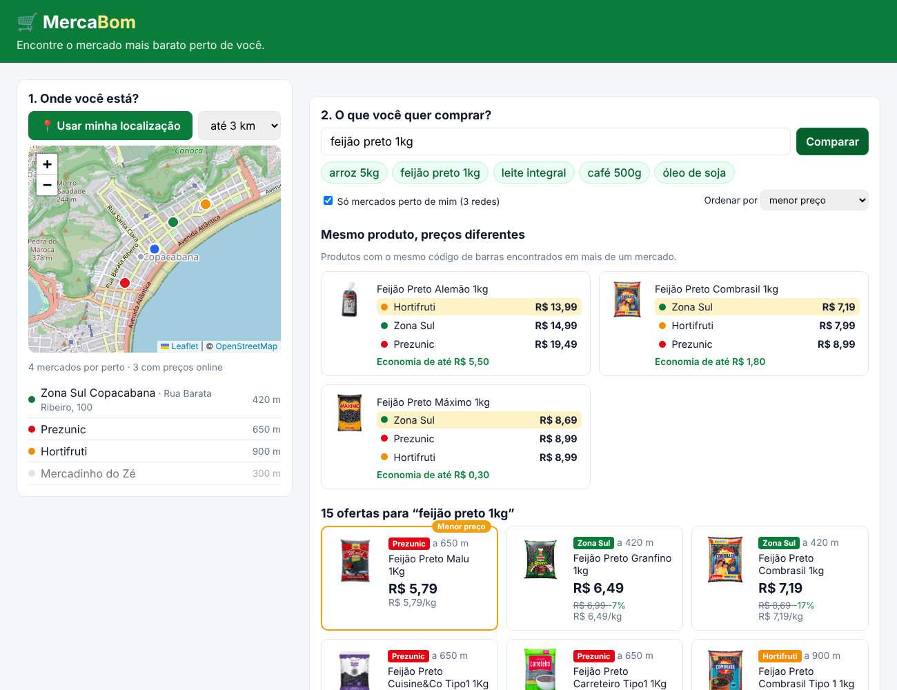

# 🛒 MercaBom

Compare o preço de um produto nos supermercados perto de você.



## Como funciona

1. **Localização**: o navegador pega sua posição (ou você clica no mapa).
2. **Mercados próximos**: o servidor consulta o [OpenStreetMap](https://www.openstreetmap.org) (API Overpass) e lista os supermercados num raio de 1 a 10 km.
3. **Preços**: cada rede reconhecida que tem loja online na plataforma **VTEX** (Zona Sul, Prezunic, Hortifruti, Carrefour, Sam's Club…) é consultada pela API pública de busca:
   `https://<loja>/api/io/_v/api/intelligent-search/product_search/?query=arroz`
4. **Comparação**:
   - ofertas ordenadas por menor preço ou por **preço por kg/litro** (a quantidade é lida do nome: "5kg", "500g", "6x170g", "2L"…);
   - **mesmo produto, preços diferentes**: produtos com o mesmo código de barras (EAN) em redes diferentes ficam lado a lado.

> Os preços são os das lojas online de cada rede. Na loja física o valor pode ser diferente.

## Rodando

Precisa do Node 20 ou mais novo.

```bash
npm install
npm run dev       # API em :3001 e site em http://localhost:5173
npm test          # testes (vitest)
```

Em produção:

```bash
npm run build
npm start         # serve a API e o site em http://localhost:3001
```

## Estrutura

```
shared/   código usado pelo site e pelo servidor (tipos, redes, quantidade, comparação)
server/   API Express: /api/search, /api/nearby, /api/chains
src/      site React (Vite + Leaflet)
tests/    testes
```

O servidor existe porque os sites dos mercados não deixam o navegador chamar a API deles direto (CORS).

## Adicionando um mercado

Edite `shared/chains.ts`. A rede precisa ter loja online VTEX. Para conferir, abra
`https://<dominio>/api/io/_v/api/intelligent-search/product_search/?query=arroz`. Se vier um JSON com `products`, é só adicionar:

```ts
{ id: "minharede", name: "Minha Rede", domain: "www.minharede.com.br", color: "#123456", osmMatch: ["minha rede"] },
```

`osmMatch` são os termos (minúsculos, sem acento) que identificam a rede no nome dos mercados no OpenStreetMap.

## Próximos passos

- Preço regionalizado: algumas redes mudam o preço por CEP (VTEX `regionId`), o que permite mostrar o preço da loja mais próxima.
- Lista de compras: somar o carrinho inteiro em cada mercado e dizer onde sai mais barato.
- Redes fora da VTEX (Guanabara, Mundial, Pão de Açúcar, Assaí…).
- Cache das buscas no servidor.
